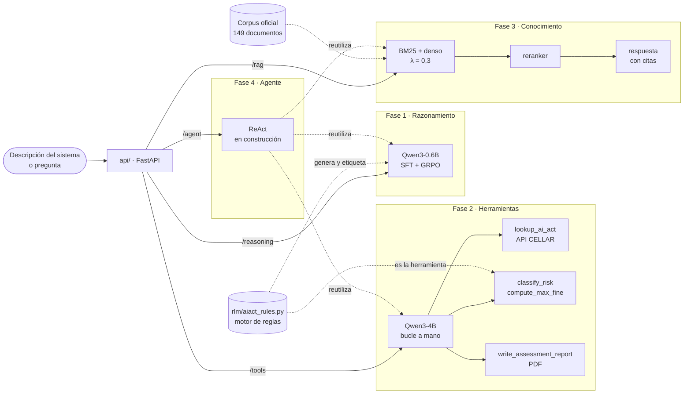

# ARCA · Clasificador de riesgo del AI Act

**Agente con Razonamiento, Conocimiento y Acción** sobre el Reglamento (UE) 2024/1689 de
inteligencia artificial. Práctica final de Modelos Generativos Profundos (Máster en IA, ICAI,
2026-2027). Equipo: Almudena Garrido, Gloria Vidal-Quadras y Victoria Guillén.

Le describes un sistema de IA en lenguaje natural («un banco usa un modelo que puntúa la
solvencia de quienes piden un préstamo») y te dice si es **prohibido**, **alto riesgo**,
**riesgo limitado** o **riesgo mínimo**, con el artículo o el punto del anexo que lo justifica.
Puede consultar el texto oficial, calcular la multa máxima, escribir un informe en PDF y
responder preguntas sobre el reglamento citando los pasajes que usa.

**Para quién.** Responsables de compliance o del área legal de empresas que van a desplegar un
sistema de IA y necesitan una primera clasificación razonada, sin leerse las 144 páginas del
reglamento cada vez ni encargar una consulta externa. No sustituye a un jurista: da la etiqueta,
la cita y el razonamiento para que alguien los revise.

> **Estado (2026-11-16):** fases 1, 2 y 3 terminadas y servidas por la API. La fase 4 (agente)
> funciona y está medida con los cerebros `base` y `thinking`; faltan el cerebro `rlm` y los
> experimentos de memoria y de herramienta rota. El cuaderno de experimentos completo está en
> [`docs/EXPERIMENTS.md`](docs/EXPERIMENTS.md).

---

## Cómo funciona



La pieza que une todo es un **motor de reglas** (`rlm/aiact_rules.py`) que aplica la precedencia
del reglamento: Art. 5 (prácticas prohibidas), Art. 6.1 y Anexo I (componentes de seguridad),
Anexo III con las excepciones del Art. 6.3, y las obligaciones de transparencia del Art. 50.
Genera y etiqueta los datos de entrenamiento de la fase 1, hace de verificador de las
recompensas y es la herramienta de cálculo de la fase 2. El mapa de ficheros está en
[`docs/ARQUITECTURA.md`](docs/ARQUITECTURA.md).

---

## Métricas

Todas las cifras salen de `reports/` y están explicadas, con sus fallos, en
[`docs/EXPERIMENTS.md`](docs/EXPERIMENTS.md).

### Fase 1 · Razonamiento (`/reasoning`)

Qwen3-0.6B: destilación de un profesor Qwen3-8B filtrada con el motor (se acepta el 77,5 % de
las trazas y quedan 1758 para el SFT), SFT con LoRA y GRPO con tres recompensas (formato,
etiqueta y cita del artículo). Evaluación greedy.

| Modelo | Test: etiqueta | Test: etiqueta + cita | OOD: etiqueta | OOD: etiqueta + cita |
|---|---|---|---|---|
| Qwen3-0.6B base | 26,5 % | 5,0 % | 17,0 % | 0,0 % |
| + SFT | 63,0 % | 51,5 % | 67,0 % | 61,0 % |
| **+ GRPO** | **75,5 %** | **67,0 %** | **83,0 %** | **74,0 %** |

El test (200 casos) usa las mismas familias y artículos que train, pero ninguna de sus frases:
se reescribió el 2026-11-13 tras ver que el antiguo compartía con train las frases del caso en
el 96 % de los ejemplos (allí GRPO sacaba un 82,5 %). El OOD (100 casos) es un dominio,
educación, que no aparece en el entrenamiento. Detalles en
[`docs/EXPERIMENTS.md`](docs/EXPERIMENTS.md).

### Fase 2 · Herramientas (`/tools`)

Qwen3-4B con un bucle de tool use escrito a mano (llamadas encadenadas y paralelas) y 34 casos
de banco.

| Configuración | Selección | Argumentos | Etiqueta | Respuesta correcta |
|---|---|---|---|---|
| **Con herramientas** | 97 % | 88 % | 80 % | 89 % |
| Mismo modelo sin herramientas | — | — | 0 % | 11 % |

### Fase 3 · Conocimiento (`/rag`)

Corpus oficial: el Reglamento en español, sus considerandos y tres guías de la Comisión.
Conjunto dorado de 71 preguntas (57 con respuesta y 14 sin ella). Intervalos de Wilson al 95 %.

| Etapa | Métrica | Resultado |
|---|---|---|
| Recuperación | hit@5 / MRR (híbrido + consulta traducida + reranker) | 0,84 [0,73, 0,92] / 0,65 |
| Respuesta | Correcta según el juez | 89 % [79, 95] |
| Respuesta | Fiel a las citas | 96 % [88, 99] |
| «No lo sé» | Rechazos falsos / rechazos correctos | 0 % / 93 % |

### Fase 4 · Agente (`/agent`)

Bucle ReAct propio sobre las herramientas de la fase 2 y la base de conocimiento de la fase 3,
comparado con un `CodeAgent` de `smolagents`. Banco de 20 tareas de al menos dos herramientas
(2 imposibles), 10 pasos como máximo. Intervalos de Wilson al 95 %.

| Agente | Cerebro | Éxito | Herramientas requeridas | s/tarea |
|---|---|---|---|---|
| **JSON, plantilla nativa de Qwen3** | **Qwen3-1.7B thinking** | **45 % [26, 66]** | 65 % | 29 |
| JSON, prompt ReAct de texto | Qwen3-1.7B thinking | 30 % [15, 52] | 35 % | 42 |
| Código (smolagents) | Qwen3-1.7B thinking | 20 % [8, 42] | 45 % | 172 |
| JSON, plantilla nativa de Qwen3 | Qwen3-0.6B base | 5 % [1, 24] | 5 % | 5 |

El 0.6B no llega a llamar a las herramientas. Los fallos del 1.7B ya no son de formato, sino de
contenido: le pasa hechos equivocados a `classify_risk` o escoge mal el dato que le devuelve la
base de conocimiento. Las dos tareas imposibles las resuelve con «No puedo responder». El cerebro
`rlm` (Qwen3-0.6B + GRPO) está pendiente.

---

## Levantarlo

Hace falta Python 3.11 y [`uv`](https://docs.astral.sh/uv/), o Docker con
`nvidia-container-toolkit`.

```bash
cp .env.example .env          # configuración de las cuatro fases
docker compose up api         # API en http://localhost:8000/docs
```

Sin Docker:

```bash
uv sync --extra train --extra rag --extra agent
uv run python -m rag.download_corpus   # corpus de la fase 3 (no se versiona)
uv run arca-api
```

`GET /health` dice qué fases están listas. Los pesos de la fase 1 (`rlm/weights/`) y el corpus
(`rag/corpus/`) no van en el repositorio. El corpus se regenera con el script de arriba. Los
pesos salen de `rlm/train_sft.py` y `rlm/train_grpo.py` (ver [`rlm/README.md`](rlm/README.md)).

```bash
curl -s -X POST localhost:8000/reasoning -H 'Content-Type: application/json' \
  -d '{"question": "Una empresa usa un sistema que filtra currículums para preseleccionar candidatos."}'
```

### Comprobaciones

```bash
uv run pytest    # tests sin GPU ni red
make audit       # auditoría de los datos de la fase 1 y del conjunto dorado
make lint
```

---

## Estructura

| Carpeta | Qué hay |
|---|---|
| [`rlm/`](rlm/README.md) | Motor de reglas, generador de datos, verificador, destilación, SFT, GRPO (y un paso de GRPO a mano), evaluación |
| [`tool_use/`](tool_use/README.md) | Herramientas del AI Act, bucle de tool use y banco de 34 casos |
| [`rag/`](rag/README.md) | Descarga del corpus, chunking semántico, retrievers, reranker, generación con citas, juez y calibración |
| [`agent/`](agent/README.md) | Agente ReAct (fase 4) |
| [`api/`](api/README.md) | API FastAPI con los cuatro endpoints |
| [`docs/`](docs/) | Propuesta, cuaderno de experimentos, arquitectura, enunciado y README original de la plantilla |
| `reports/` | Métricas, curvas y predicciones de cada evaluación |

Basado en la plantilla [`kendrickcetina/dgm-arca`](https://github.com/kendrickcetina/dgm-arca);
el README original está en [`docs/README_plantilla.md`](docs/README_plantilla.md).
